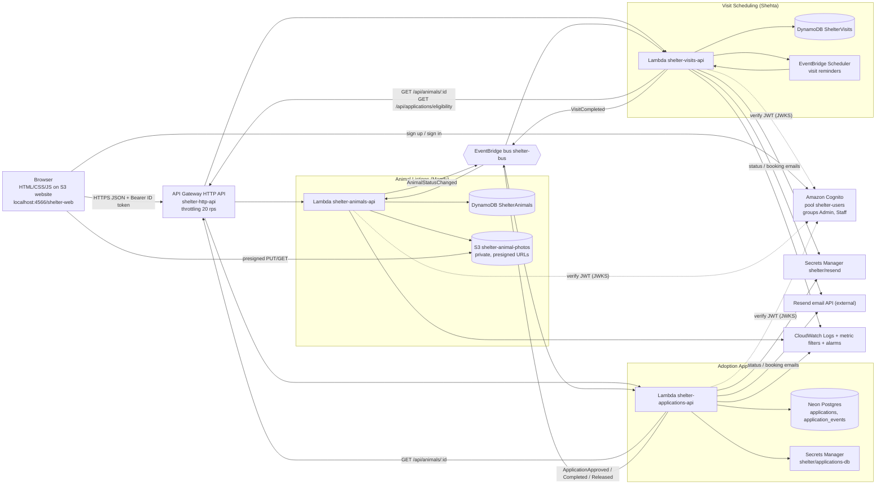

# Architecture

## How the layers talk
* **Browser to Cognito**: `InitiateAuth` / `SignUp` (same origin as the website). The ID token is kept in `sessionStorage`.
* **Browser to API Gateway to Lambda**: REST + JSON. Every service verifies the token itself: RS256 signature against Cognito JWKS, plus issuer, audience, expiry and `token_use`. The role comes from `cognito:groups`.
* **Service to service, synchronous**: through the same API Gateway, forwarding the user's own token, so the called service applies its own rules. Nobody reads another service's database.
* **Service to service, asynchronous**: EventBridge events on `shelter-bus`. Each IAM role may only publish with its own `source`.

## Events
| Event | Source | Consumer | Effect |
|---|---|---|---|
| ApplicationApproved | shelter.applications | Animals | available → reserved (pinned to the application) |
| ApplicationCompleted | shelter.applications | Animals | reserved → adopted |
| ApplicationReleased | shelter.applications | Animals | reserved → available |
| AnimalStatusChanged (adopted/archived/on_hold) | shelter.animals | Visits | cancel future slots and bookings, email adopters |
| VisitCompleted | shelter.visits | Applications | record visit; submitted → under_review; unlocks approval |
| VisitReminder (Scheduler) | scheduler | Visits | reminder email 24 h before |

## Role / permission matrix (enforced in the backend)
| Action | Visitor | Adopter | Staff | Admin | Where enforced |
|---|---|---|---|---|---|
| Browse available animals, open slots | ✓ | ✓ | ✓ | ✓ | Animals `list` (status forced to available for non-staff), Visits `listSlots` |
| See on-hold/archived animals, internal fields | | | ✓ | ✓ | Animals `isStaff` in `list`/`present` |
| Create / edit / hold / archive animal, photos | | | ✓ | ✓ | `requireRole(staff,admin)` in animals routes |
| Submit application (max 3 active) | | ✓ | | | `requireRole(adopter)` + `countActive` |
| Read application | | own only | all | all | SQL `WHERE adopter_id = $sub` (404 otherwise) |
| Withdraw application | | own only | | | `TRANSITIONS` owner rule |
| Review / approve / reject / complete, notes | | | ✓ | ✓ | `TRANSITIONS` staff rule, `requireRole` on notes |
| Open / cancel visit slots | | | ✓ | ✓ | `requireRole` in visits routes |
| Book visit | | with active application | | | `requireRole(adopter)` + eligibility call |
| Cancel booking | | own, ≥24 h before | any, before start | any | `updateBooking` |
| Record visit outcome | | | ✓ | ✓ | `updateBooking` (403 for adopters) |
| Grant Staff/Admin | | | | Cognito admin only | groups are never self-assigned (PreSignUp adds none) |
